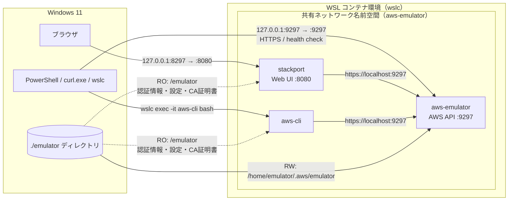
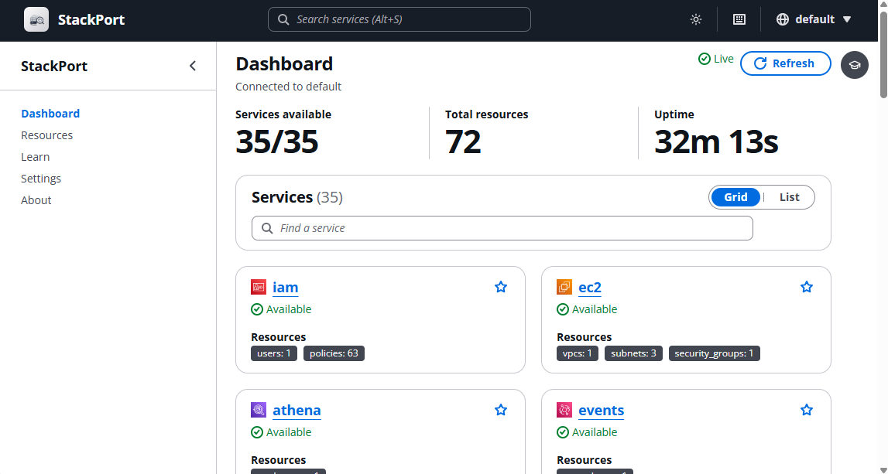
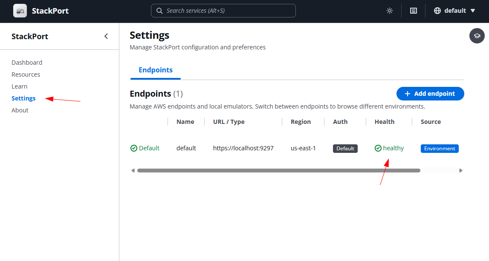
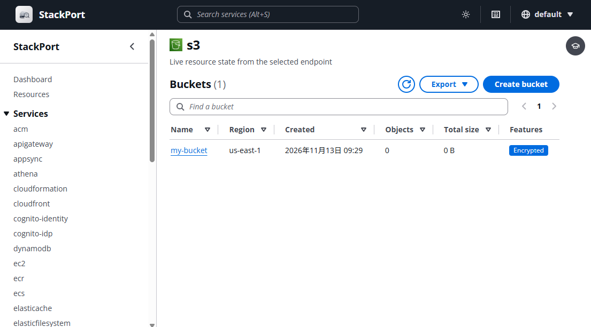

# aws_emulator_study1

## 概要

* 公式の AWS ローカルエミュレーターが出たので試してみる

AWS Emulator  
https://github.com/aws/aws-emulator  
AWS Emulator は、AWS API のローカルエミュレータです。AWS を呼び出すことなく、自分のマシン、開発サーバー、または継続的インテグレーション (CI) 環境でソフトウェアをテストするために使用できます。AWS アカウントは不要です。

## 詳細

### 環境

* Windows 11
* WSL コンテナ―  
  ```
  > wslc --version
  wslc 3.0.5.0
  ```

### 留意事項

* AWS エミュレーターの状態を GUI で確認できる StackPort も併せて構築

StackPort  
https://stackport.cloud/  
ローカルエミュレーターと実際のAWSアカウントに対応した、汎用的なAWSリソースブラウザ。  
S3、DynamoDB、Lambda、SQS、IAM、EC2、CloudWatch Logs、Secrets Manager専用のUIを使用して、35種類のAWSサービスにわたるリソースを閲覧、検査、管理できます。

### 構成



### aws-emulator イメージをビルド

Getting started with Docker  
https://docs.aws.amazon.com/emulator/latest/userguide/getting-started-docker.html  

Dockerfile
```Dockerfile
FROM public.ecr.aws/amazonlinux/amazonlinux:2023-minimal
ADD https://downloads.aws.com/aws-emulator/packages/aws-emulator/LTS/latest/aws-emulator-x86_64.rpm /tmp/aws-emulator.rpm
RUN rpm -i /tmp/aws-emulator.rpm && rm /tmp/aws-emulator.rpm \
    && mkdir -p /home/emulator && chown 1000 /home/emulator
USER 1000
ENV HOME=/home/emulator
EXPOSE 9297
ENTRYPOINT ["aws-emulator", "-b", "0.0.0.0"]
```

```sh
wslc build -t aws-emulator .
```

### aws-emulator コンテナを起動

```sh
wslc run -d `
  --name aws-emulator `
  -p "127.0.0.1:9297:9297" `
  -p "127.0.0.1:8297:8080" `
  -v ".\emulator:/home/emulator/.aws/emulator" `
  aws-emulator -p 9297 --telemetry off
```

以下で ok が返るまで待つ
```sh
curl.exe -sf --cacert ./emulator/9297/ca.pem https://127.0.0.1:9297/__admin/health
```

### stackport コンテナを起動

https://hub.docker.com/r/davireis/stackport/tags

```sh
wslc run -d `
  --name stackport `
  --network container:aws-emulator `
  -v "./emulator:/emulator:ro" `
  -e AWS_ENDPOINT_URL=https://localhost:9297 `
  -e AWS_SHARED_CREDENTIALS_FILE=/emulator/9297/emulator_credentials `
  -e AWS_CONFIG_FILE=/emulator/9297/config `
  -e AWS_CA_BUNDLE=/emulator/9297/ca.pem `
  -e AWS_EC2_METADATA_DISABLED=true `
  -e AWS_DISABLE_HOST_PREFIX_INJECTION=true `
  -e AWS_REGION=us-east-1 `
  -e AWS_DEFAULT_REGION=us-east-1 `
  davireis/stackport:0.4.6
```

### StackPort にアクセス

※起動直後はリソース情報の取得で 2 ～ 3 分何も表示されない

http://localhost:8297



いつまで待っても表示されない場合は aws-emulator に接続できているか確認




### aws-cli コンテナを起動

```sh
wslc run -d `
  --name aws-cli `
  --network container:aws-emulator `
  -v "./emulator:/emulator:ro" `
  -e AWS_ENDPOINT_URL=https://localhost:9297 `
  -e AWS_SHARED_CREDENTIALS_FILE=/emulator/9297/emulator_credentials `
  -e AWS_CONFIG_FILE=/emulator/9297/config `
  -e AWS_CA_BUNDLE=/emulator/9297/ca.pem `
  -e AWS_EC2_METADATA_DISABLED=true `
  -e AWS_DISABLE_HOST_PREFIX_INJECTION=true `
  -e AWS_REGION=us-east-1 `
  -e AWS_DEFAULT_REGION=us-east-1 `
  --entrypoint sleep `
  amazon/aws-cli:latest infinity
```

### aws-cli コンテナに接続

```sh
wslc exec -it aws-cli bash
```

バージョン確認と接続確認

```sh
> wslc exec -it aws-cli bash
bash-5.2# aws --version
aws-cli/2.40.2 Python/3.14.8 Linux/6.18.58.1-microsoft-standard-WSL2 docker/x86_64.amzn.2023
bash-5.2# aws sts get-caller-identity
{
    "UserId": "AIDAH5I7GEMO7ADXNFAZU",
    "Account": "000000000000",
    "Arn": "arn:aws:iam::000000000000:user/emulator"
}
```

### S3 の操作を試す

```sh
# バケット作成
aws s3 mb s3://my-bucket
aws s3 ls

# アップロード
echo aiueo > aiueo.txt
aws s3 cp ./aiueo.txt s3://my-bucket/
aws s3 ls s3://my-bucket

# ダウンロード
aws s3 cp s3://my-bucket/aiueo.txt ./aiueo2.txt
cat aiueo2.txt

# 削除
aws s3 rm s3://my-bucket/aiueo.txt
aws s3 ls s3://my-bucket

# バケット削除
aws s3 rb s3://my-bucket
aws s3 ls
```



### 掃除

```sh
wslc rm -f aws-cli
wslc rm -f stackport
wslc rm -f aws-emulator
```